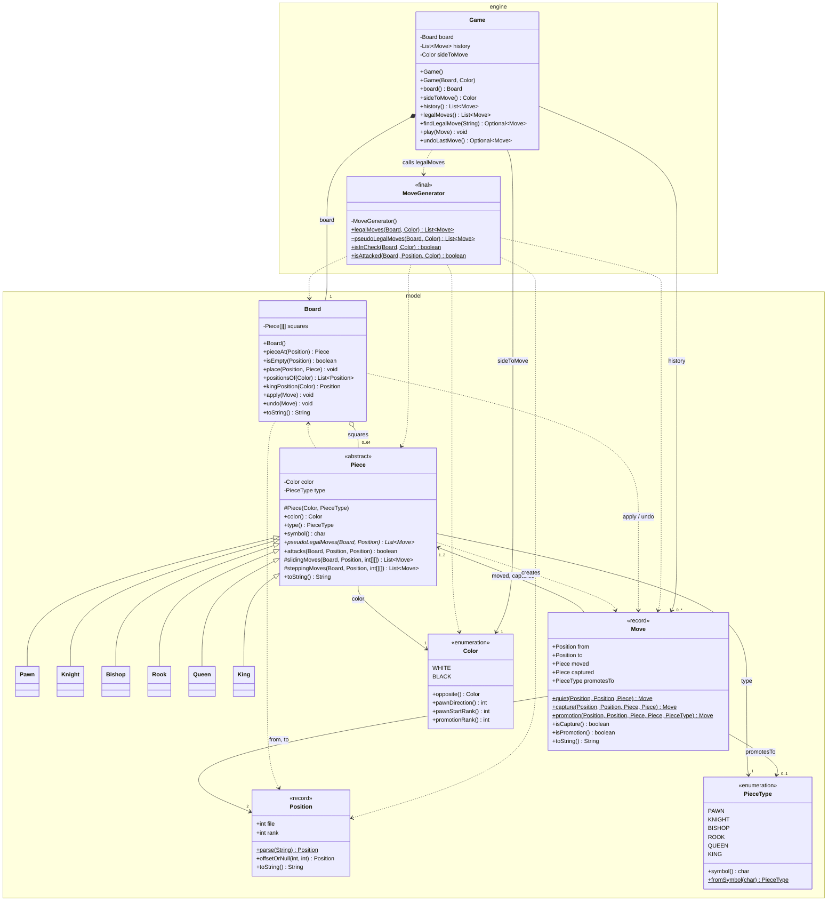
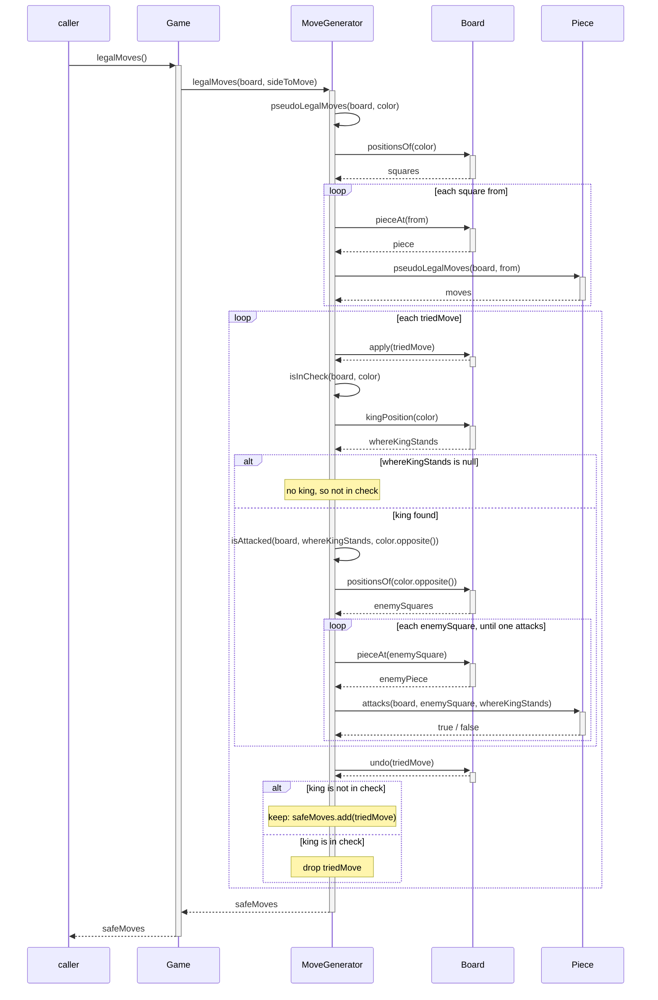

# Design

Two diagrams of the engine as it stands after M5. Both are drawn from the code
in `src/main/java`; if the two disagree, the code is right and this file is stale.

## Class diagram: `engine` and `model`

The six piece subclasses are drawn without their methods: each one has the same
public constructor and overrides `pseudoLegalMoves`, and `Pawn` also overrides
`attacks`.

## Sequence diagram: `game.legalMoves()` after M5

One `Piece` lifeline stands for every piece asked. The first loop is the M4
generation loop, unchanged; the second is the M5 filter. Every candidate is
undone before the next one is tried, so the board ends exactly as it started.

